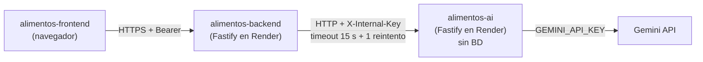

# alimentos-ai

Microservicio de IA de **AlimentaIQ — Centro Inteligente de Distribución de Alimentos**. Lo llama
**únicamente** `alimentos-backend`, servidor a servidor, protegido con el header `X-Internal-Key`.
No tiene base de datos ni código compartido con otros repos, y es el **único** servicio que conoce
la `GEMINI_API_KEY`.

- Stack: Node 22 LTS · Fastify 5 · TypeScript estricto · Zod.
- Despliegue: Render.
- Estado: esqueleto seguro. La integración con Gemini y los endpoints de negocio llegan en la
  fase 3.

## Arquitectura



El navegador nunca llama a este servicio (por eso no hay CORS). El backend arma el contexto
filtrado por rol y solo envía lo necesario.

## Contrato (sección 5 de `api-contract.md`)

| Método | Ruta                       | Auth             | Respuesta                                                                       |
| ------ | -------------------------- | ---------------- | ------------------------------------------------------------------------------- |
| GET    | `/health`                  | público          | `{ status, model }`                                                             |
| POST   | `/v1/proposal-explanation` | `X-Internal-Key` | `{ summary, highlights[], tieBreakOrder? }`                                     |
| POST   | `/v1/rescue-plan`          | `X-Internal-Key` | `{ actions: [{ product, action: DONATE\|REALLOCATE\|PRIORITIZE, rationale }] }` |
| POST   | `/v1/briefing` (EXTRA)     | `X-Internal-Key` | `{ summary, topActions[] }`                                                     |

### Implementado en esta fase

| Método | Ruta       | Auth             | Respuesta                                                                     |
| ------ | ---------- | ---------------- | ----------------------------------------------------------------------------- |
| GET    | `/health`  | público          | `{ status: "ok", service: "alimentos-ai", version, model, geminiConfigured }` |
| GET    | `/v1/ping` | `X-Internal-Key` | `{ pong: true }`                                                              |

`/health` amplía el contrato con `service`, `version` y `geminiConfigured` (booleano). Nunca
devuelve ninguna clave.

`/v1/ping` es **temporal**: solo sirve para probar la autenticación interna de punta a punta y se
reemplaza por los endpoints de negocio en la fase 3.

## Autenticación interna

- Todo lo que está bajo `/v1` (incluidas las rutas inexistentes) exige `X-Internal-Key`.
- La comparación usa `crypto.timingSafeEqual` sobre los hashes SHA-256 de la clave recibida y de
  `AI_INTERNAL_KEY`. Así los buffers siempre tienen el mismo largo y no se filtra la longitud de la
  clave por tiempo.
- Si falta o no coincide: `401 UNAUTHORIZED`, con la misma respuesta en ambos casos.
- La clave nunca se registra: el logger redacta `x-internal-key`, `authorization` y `cookie`.

## Errores

Formato: `{ "error": { "code": "STRING", "category"?: "STRING", "message": "texto" } }`.

| `code`             | HTTP | Cuándo                                        |
| ------------------ | ---- | --------------------------------------------- |
| `VALIDATION_ERROR` | 400  | Entrada inválida (Zod)                        |
| `UNAUTHORIZED`     | 401  | Falta `X-Internal-Key` o no coincide          |
| `NOT_FOUND`        | 404  | Ruta inexistente                              |
| `INTERNAL_ERROR`   | 500  | Error inesperado (sin detalles en producción) |

**Categorías de IA** (`code` y `category` llevan el mismo valor; el backend usa `category` para su
`503 AI_UNAVAILABLE`):

| `category`        | HTTP sugerido |
| ----------------- | ------------- |
| `MODEL_NOT_FOUND` | 502           |
| `QUOTA_EXCEEDED`  | 429           |
| `TIMEOUT`         | 504           |
| `UPSTREAM_ERROR`  | 502           |
| `INVALID_API_KEY` | 500           |

Nunca se envían stack traces.

## Variables de entorno

Plantilla en [.env.example](.env.example). Nunca se commitean valores reales.

| Variable                 | Obligatoria | Uso                                                    |
| ------------------------ | ----------- | ------------------------------------------------------ |
| `NODE_ENV`               | Sí          | `development` · `test` · `production`                  |
| `PORT`                   | No          | Render lo inyecta; en local 4100 por defecto           |
| `AI_INTERNAL_KEY`        | Sí          | Clave compartida con el backend (mínimo 32 caracteres) |
| `GEMINI_API_KEY`         | Fase 3      | Clave de Gemini (solo este servicio la conoce)         |
| `GEMINI_MODEL`           | Fase 3      | Modelo de Gemini                                       |
| `AI_UPSTREAM_TIMEOUT_MS` | Fase 3      | Timeout de las llamadas a Gemini                       |

Las variables vacías cuentan como no definidas. Si falta una obligatoria, el servidor no arranca e
indica cuál falta, sin mostrar valores.

## Puesta en marcha local

```bash
npm ci
cp .env.example .env   # y completa los valores
npm run dev
curl -i http://localhost:4100/health
curl -i -H "X-Internal-Key: $AI_INTERNAL_KEY" http://localhost:4100/v1/ping
```

## Scripts

| Script                 | Descripción                          |
| ---------------------- | ------------------------------------ |
| `npm run dev`          | Servidor en modo watch (`tsx watch`) |
| `npm run build`        | Compila TypeScript a `dist/`         |
| `npm start`            | Ejecuta `dist/server.js`             |
| `npm test`             | Pruebas con Vitest                   |
| `npm run lint`         | ESLint con reglas type-aware         |
| `npm run typecheck`    | `tsc --noEmit`                       |
| `npm run format`       | Formatea con Prettier                |
| `npm run format:check` | Verifica el formato (lo usa CI)      |

## Puertos

| Servicio             | Puerto local |
| -------------------- | ------------ |
| `alimentos-frontend` | 3000         |
| `alimentos-backend`  | 4000         |
| `alimentos-ai`       | 4100         |

## Despliegue en Render

| Ajuste        | Valor                                   |
| ------------- | --------------------------------------- |
| Build Command | `npm ci --include=dev && npm run build` |
| Start Command | `npm start`                             |
| Health Check  | `/health`                               |
| `PORT`        | No se define: Render lo inyecta         |

`AI_INTERNAL_KEY` debe ser la misma en este servicio y en el backend. Las claves se configuran en
el panel de Render.

## CI

GitHub Actions en cada push y PR a `main`: `npm ci`, lint, formato, typecheck, pruebas y build.
Usa una `AI_INTERNAL_KEY` falsa de 64 caracteres definida en el workflow (no es un secreto real).
